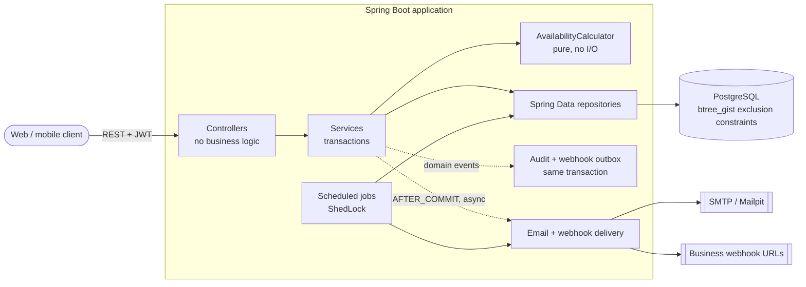
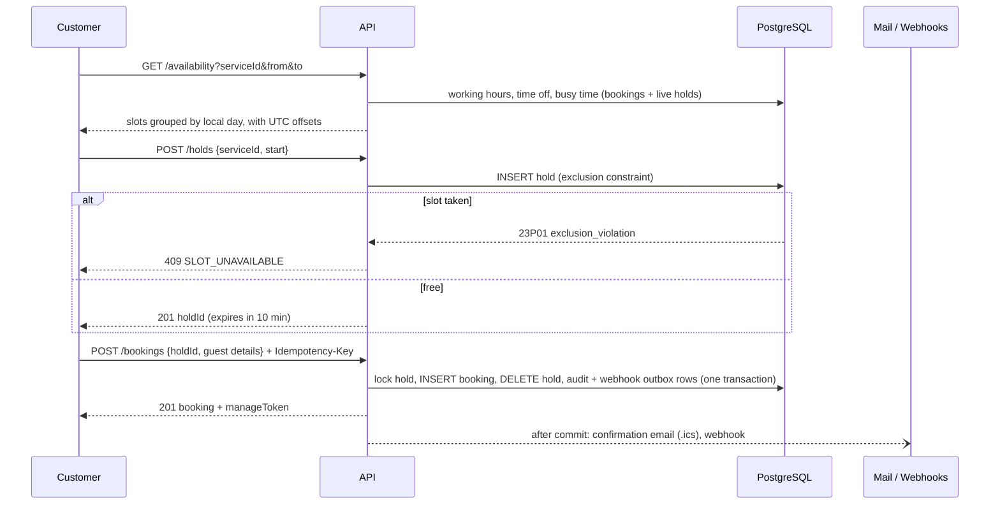

# Slotwise

**Slotwise is the booking engine behind an appointment-based business.** A clinic, salon, tutor or
consultant sets up their staff, services and opening hours; customers see the times that are really
free and book one. Two people can never get the same slot – even when a hundred people click at the
same second – the system gets daylight-saving time right, sends confirmation and reminder emails
with a calendar invite, enforces cancellation rules, and can notify the business's own software
through webhooks.

This repository is the backend (REST API) for that product, built with Java 21 and Spring Boot 3.
It is meant to show how such a system is built properly: clean layering, correct transactions and
concurrency, security, tests and documentation.

---

## Features

| Area | What it does |
|---|---|
| **Availability** | Working hours − time off − bookings − unexpired holds − buffers, cut into slots; honours minimum notice, maximum advance window and slot interval. Any-staff or specific staff. DST-safe. |
| **Double-booking prevention** | PostgreSQL `EXCLUDE USING gist` constraints on `tstzrange` for bookings and holds. Proven by a 20-thread test. |
| **Two-step booking** | `POST /v1/holds` reserves a slot for 10 minutes, `POST /v1/bookings` confirms it. Expired holds stop blocking immediately. |
| **Guest or account** | Customers book with or without an account; guests get a signed **manage link** to view, reschedule or cancel. |
| **Idempotency** | `Idempotency-Key` header: a retried request returns the original booking. |
| **Cancel / reschedule rules** | Business-specific cutoff (e.g. 24 h); owners can override. Reschedule is atomic. Optimistic locking (`@Version`). |
| **Notifications** | Confirmation, reschedule, cancellation and 24 h / 1 h reminder emails (Thymeleaf), `.ics` attachment, times in the business's time zone. Sent after commit, asynchronously. |
| **Webhooks** | `booking.created` / `rescheduled` / `cancelled`, HMAC-SHA256 signed, retried with backoff, every attempt logged, SSRF-guarded. |
| **Owner & staff tools** | Filterable paginated booking list, statistics, personal schedule, iCal subscription feed, mark completed / no-show. |
| **Security** | JWT access tokens + rotating refresh tokens, BCrypt, roles (`OWNER`, `STAFF`, `CUSTOMER`), per-business authorization, rate limiting, RFC 7807 errors. |
| **Audit log** | Who changed what, with before/after JSON, written in the same transaction as the change. |

## Architecture



Package-by-feature: `auth`, `business`, `staff`, `offering` (the bookable "services" – named to avoid
confusion with Spring's `@Service`), `availability`, `booking`, `notification`, `audit`, `config`,
`common`. Each has its own `controller`, `service`, `repository`, `dto`, `entity`, `mapper` as needed.

### Booking flow



## Quick start

### With Docker

```bash
cp .env.example .env        # optional, defaults work
docker compose up --build
```

- API: <http://localhost:8080> · Swagger UI: <http://localhost:8080/swagger-ui.html>
- Mailpit (all outgoing email): <http://localhost:8025>
- The `dev` profile seeds a demo business, so you can book immediately:

| Login | Password | Role |
|---|---|---|
| `owner@demo.test` | `demo-password-123` | owner of **Demo Clinic** (`demo-clinic`, Europe/Berlin) |
| `mia@demo.test`, `tom@demo.test` | `demo-password-123` | staff |
| `customer@demo.test` | `demo-password-123` | customer |

### Without Docker

Needs Java 21 and a PostgreSQL 14+ database (user/db/password `slotwise`, or set `DB_URL`, `DB_USER`,
`DB_PASSWORD`):

```bash
JWT_SECRET=$(openssl rand -base64 48) SPRING_PROFILES_ACTIVE=dev ./mvnw spring-boot:run
```

### Try a full booking (curl)

`scripts/demo.sh` runs exactly the steps below against a running instance (`jq` required):

```bash
BASE=http://localhost:8080
SERVICE=$(curl -s $BASE/v1/businesses/demo-clinic/public | jq -r '.services[] | select(.name=="Consultation").id')
DAY=$(date -d "next wednesday" +%F)        # macOS: date -v+wed +%F

# 1. check availability
SLOTS=$(curl -s "$BASE/v1/businesses/demo-clinic/availability?serviceId=$SERVICE&from=$DAY&to=$DAY")
echo $SLOTS | jq '.days[0].slots[0:3]'
START=$(echo $SLOTS | jq -r '.days[0].slots[2].start')

# 2. hold a slot for 10 minutes (a second request for the same slot/staff returns 409)
HOLD_ID=$(curl -s -X POST $BASE/v1/holds -H 'Content-Type: application/json' \
  -d "{\"serviceId\":\"$SERVICE\",\"start\":\"$START\"}" | jq -r .holdId)

# 3. confirm the booking as a guest; keep the manage token
BOOKING=$(curl -s -X POST $BASE/v1/bookings -H 'Content-Type: application/json' -H 'Idempotency-Key: my-retry-safe-key-1' \
  -d "{\"holdId\":\"$HOLD_ID\",\"guestName\":\"Sam Guest\",\"guestEmail\":\"sam@example.com\"}")
ID=$(echo $BOOKING | jq -r .id); TOKEN=$(echo $BOOKING | jq -r .manageToken)

# 4. reschedule to another free slot that day, then 5. cancel – no account needed, the token is the key
NEW=$(echo $SLOTS | jq -r '.days[0].slots[8].start')
curl -s -X POST $BASE/v1/bookings/$ID/reschedule -H "X-Manage-Token: $TOKEN" -H 'Content-Type: application/json' \
  -d "{\"newStart\":\"$NEW\"}" | jq '{status,start}'
curl -s -X POST $BASE/v1/bookings/$ID/cancel -H "X-Manage-Token: $TOKEN" | jq '{status}'
```

Owner calls need a bearer token:

```bash
OWNER=$(curl -s -X POST $BASE/v1/auth/login -H 'Content-Type: application/json' \
  -d '{"email":"owner@demo.test","password":"demo-password-123"}' | jq -r .accessToken)
BIZ=$(curl -s $BASE/v1/businesses -H "Authorization: Bearer $OWNER" | jq -r '.[0].id')
curl -s "$BASE/v1/businesses/$BIZ/bookings?size=5" -H "Authorization: Bearer $OWNER" | jq '.content[] | {start,status,guestEmail}'
curl -s "$BASE/v1/businesses/$BIZ/stats?from=2030-01-01&to=2030-12-31" -H "Authorization: Bearer $OWNER" | jq
```

## API overview

Full, always-current documentation with schemas: Swagger UI at `/swagger-ui.html`, spec at `/v3/api-docs`.

| Method | Path | Access |
|---|---|---|
| POST | `/v1/auth/register`, `/login`, `/refresh`, `/logout` | public |
| POST/GET/PATCH | `/v1/businesses`, `/v1/businesses/{id}` | owner |
| GET/POST/PATCH/DELETE | `/v1/businesses/{id}/staff`, `/services` | owner |
| PUT/GET | `/v1/staff/{id}/working-hours` | owner (PUT), owner/staff (GET) |
| GET/POST/DELETE | `/v1/staff/{id}/time-off` | owner, that staff member |
| GET | `/v1/businesses/{slug}/public` | public |
| GET | `/v1/businesses/{slug}/availability` | public (rate limited) |
| POST | `/v1/holds`, `/v1/bookings` | public / customer |
| GET | `/v1/bookings/{id}` | customer, owner, staff, manage token |
| POST | `/v1/bookings/{id}/reschedule`, `/cancel` | customer, owner, manage token |
| PATCH | `/v1/bookings/{id}/status` | staff, owner (COMPLETED / NO_SHOW) |
| GET | `/v1/businesses/{id}/bookings`, `/stats`, `/audit-log` | owner |
| GET/POST/DELETE | `/v1/businesses/{id}/webhooks` (+ `/{id}/deliveries`) | owner |
| GET | `/v1/staff/{id}/schedule`, `/calendar-link` | owner, that staff member |
| GET | `/v1/staff/{id}/calendar.ics?token=` | token |
| GET | `/actuator/health` | public |

Errors are [RFC 7807](https://www.rfc-editor.org/rfc/rfc7807) Problem Details with a stable `code`
(`SLOT_UNAVAILABLE`, `HOLD_EXPIRED`, `CANCELLATION_WINDOW_CLOSED`, `VALIDATION_FAILED`, …):

```json
{ "type": "about:blank", "title": "SLOT_UNAVAILABLE", "status": 409,
  "detail": "This time slot is no longer available", "code": "SLOT_UNAVAILABLE" }
```

### Webhooks

Register an HTTPS endpoint (`POST /v1/businesses/{id}/webhooks`); the response contains the signing
secret once. Each request carries:

```
X-Slotwise-Event: booking.created
X-Slotwise-Delivery: <uuid>
X-Slotwise-Signature: t=<unix seconds>,v1=<hex HMAC-SHA256 of "<t>.<raw body>">
```

Verify by recomputing the HMAC with your secret and rejecting old timestamps. Non-2xx responses are
retried after 1 min, 5 min, 30 min, 2 h and 12 h (6 attempts in total); every attempt is visible at
`GET /v1/businesses/{id}/webhooks/{endpointId}/deliveries`.

## Design decisions

**Exclusion constraint instead of application locks.** Checking "is it free?" and then inserting is a
race. Slotwise lets PostgreSQL decide: `EXCLUDE USING gist (staff_id WITH =, time_range WITH &&)`
(`btree_gist`) on both `holds` and `bookings` (the latter ignoring cancelled rows). It works across
threads, across app instances, and for code paths nobody has written yet. The application only
translates SQLSTATE `23P01` into `409 SLOT_UNAVAILABLE`. `time_range` is a *generated* column built from
`blocked_from`/`blocked_to` (the appointment widened by the service's buffers), so buffers are enforced
by the same constraint. Ranges are half-open, so back-to-back appointments are fine.

**Holds are a separate table.** Holds and bookings can't share one exclusion constraint, so: holds
exclude holds, bookings exclude bookings, and a booking only ever starts as a confirmed hold. After
inserting a hold the service also checks for an overlapping booking (the hold insert may have waited on
a concurrent confirm), and the bookings constraint remains the final authority. An expired hold is
ignored by availability *immediately* (`expires_at > now`) and swept away by a ShedLock-guarded job; a
new hold on the same slot deletes the stale row first.

**Pure availability calculator.** `AvailabilityCalculator` takes plain data (working windows, time
off, busy intervals, policies) and a `Clock`-derived "now" and returns slots. No database, no clock, no
Spring – which is why DST cases (23 h and 25 h days, the repeated hour) are ordinary unit tests.

**UTC everywhere, local time at the edges.** All instants are `timestamptz`/`Instant`. Working hours are
stored as local wall-clock times and converted per date with the business's IANA zone; responses carry
the zone offset (`2030-03-31T03:00:00+02:00`); emails are rendered in the business's zone.

**After-commit side effects.** Emails and webhook HTTP calls run in `@TransactionalEventListener(AFTER_COMMIT)`
+ `@Async` listeners, so a slow mail server can neither block nor roll back a booking, and nothing is sent
for a rolled-back booking. Webhooks additionally use a **transactional outbox**: delivery rows are written
in the booking transaction (so no event is lost if the process dies right after commit) and a retry job
picks up anything left over.

**Exactly-once reminders.** A `(booking_id, type)` primary key in `reminders_sent` is claimed with
`INSERT … ON CONFLICT DO NOTHING` before sending; a failed send releases the claim for retry.

**Idempotency.** `Idempotency-Key` + a unique `hold_id` on bookings mean a retried confirm – even two
racing ones – yields one booking and the same response.

**Tokens.** Access tokens are short-lived JWTs; refresh tokens are random, stored only as SHA-256 hashes,
rotated on use, and presenting an already-used one revokes the whole family. Manage-link and calendar
tokens use keys derived from the JWT secret, so none of the token types is valid as another.

**Authorization is per business.** Every owner/staff operation goes through `BusinessAccess`, which checks
that the caller owns the business (or is the staff member); cross-business attempts are covered by tests.

## Configuration

Everything comes from environment variables; see [`.env.example`](.env.example) for the full list
(database, `JWT_SECRET` (≥ 32 bytes), mail, CORS origins, `PUBLIC_BASE_URL` for manage links, hold TTL,
rate limits, webhook options, `SPRING_PROFILES_ACTIVE=dev` for seed data). Set
`LOGGING_STRUCTURED_FORMAT_CONSOLE=ecs` for JSON logs. No secrets live in the code.

## Development

```bash
./mvnw spotless:apply   # format (Google Java Format)
./mvnw verify           # format check + all tests + coverage gate
```

- **Tests use a real PostgreSQL**: Testcontainers is not required – an embedded PostgreSQL
  (zonky `embedded-postgres`) starts automatically, so no Docker is needed to run the suite. H2 is
  deliberately not used because the exclusion constraints need real PostgreSQL.
- Highlights: availability unit tests incl. `Europe/Berlin` DST; `BookingConcurrencyIntegrationTest`
  (20 threads → exactly one booking, 19 × `409`; 20 concurrent overlapping inserts; 20 concurrent
  reschedules); security tests for roles and cross-business access; scheduler tests with a controllable
  `Clock`; mail captured by a test `JavaMailSender`; webhook delivery against a local HTTP server.
- JaCoCo enforces ≥ 80 % instruction coverage on the `service` and `availability` packages
  (`./mvnw verify`; report in `target/site/jacoco`).
- No Docker? `java -cp target/test-classes:… com.slotwise.support.DevPostgres` starts a throwaway
  PostgreSQL on :5432 for running the app locally.
- CI (`.github/workflows/ci.yml`): Spotless check, build, tests, coverage report artifact.

## Known limitations

- Rate-limit buckets are in memory (per instance); swap in Bucket4j's JDBC/Redis backends to share them.
- Working-hour ranges cannot cross midnight (`start < end` on one day); split them across two days.
- Webhook secrets are stored in plain text because they are needed to sign requests.
